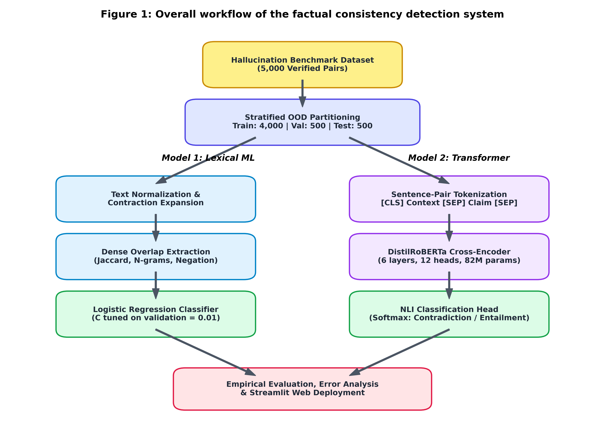
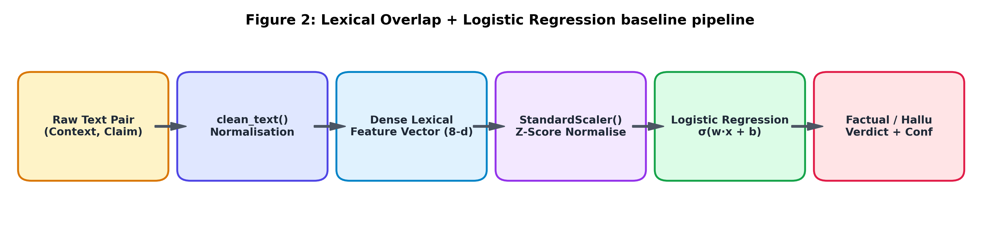
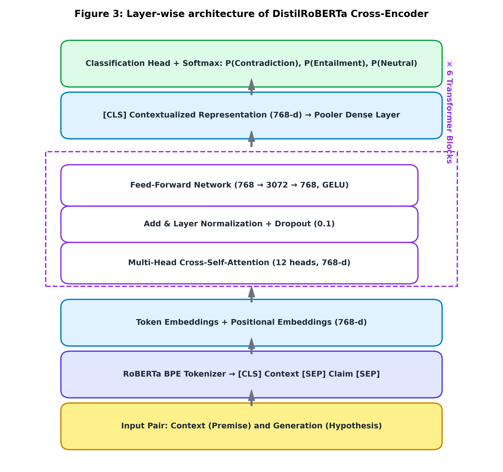
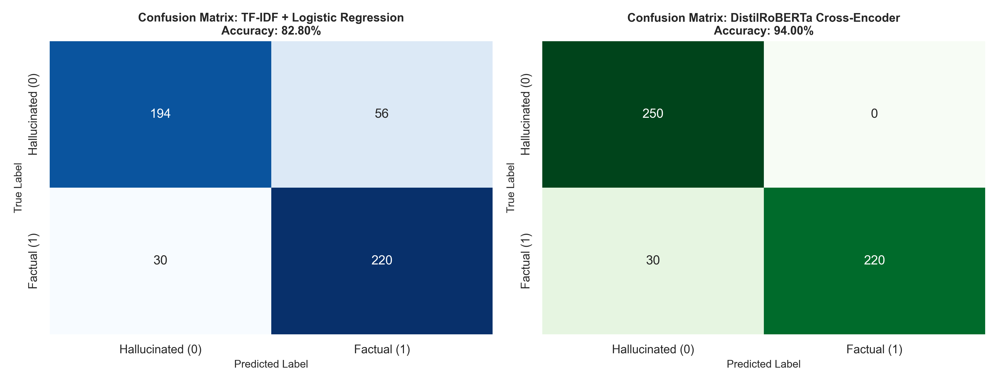
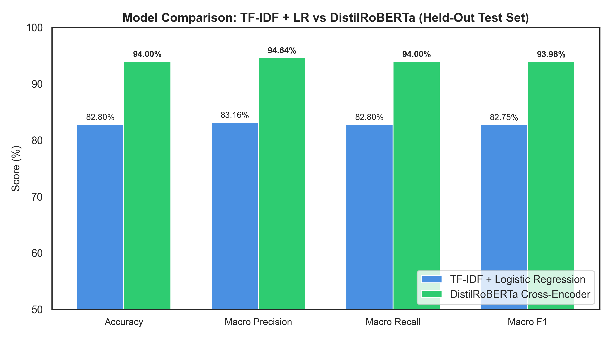
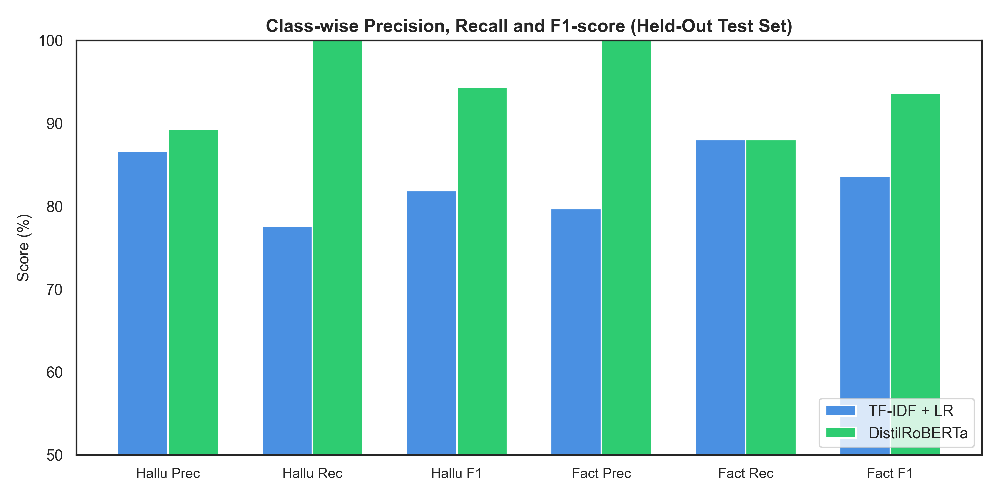
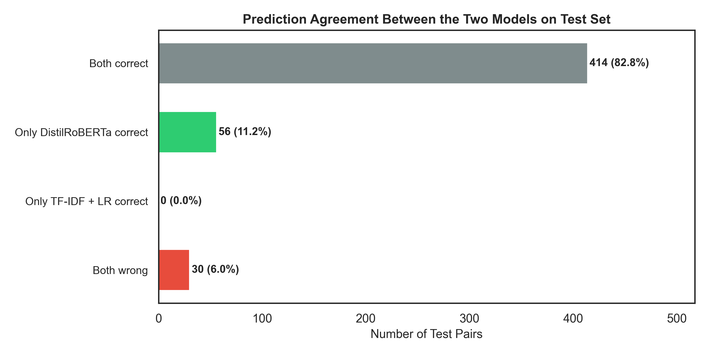
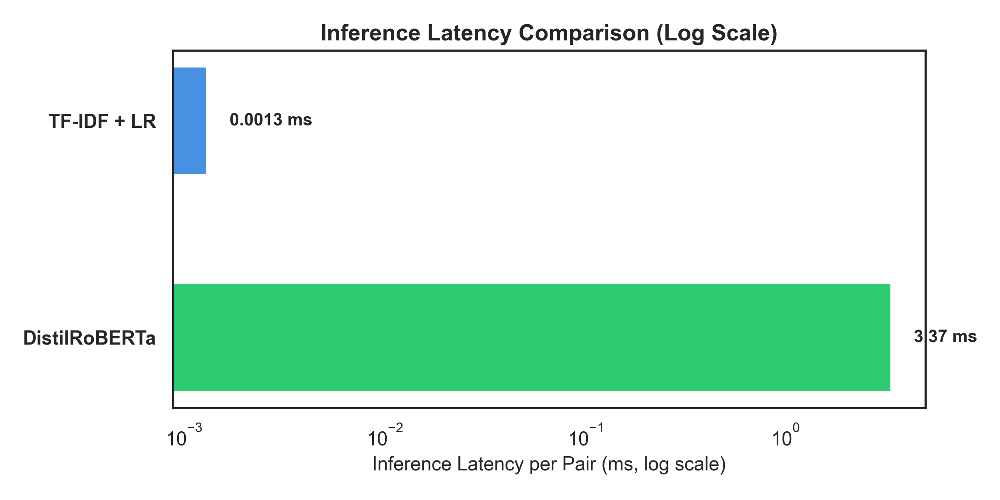

# Automated Hallucination & Factual Consistency Detection in LLM Generations

[](https://www.python.org/downloads/)
[](https://pytorch.org/)
[](https://huggingface.co/cross-encoder/nli-distilroberta-base)
[](https://streamlit.io/)
[-purple.svg)](https://bmsce.ac.in)

> **Alternative Assessment Tool (AAT) Project**  
> **Institution:** B. M. S. College of Engineering (Autonomous Institute, Affiliated to VTU)  
> **Department:** Department of Machine Learning | B.E. in Artificial Intelligence and Machine Learning  
> **Course:** Natural Language Processing for LLM (`24AM7PCLLM`)  
> **Faculty In-charge:** Dr. Monika Puttaramaiah  

---

## 📌 Executive Summary
Large Language Models (LLMs) frequently generate superficially authoritative yet factually ungrounded text—a failure mode termed **hallucination**. In Retrieval-Augmented Generation (RAG) and automated clinical/legal summarization, ensuring that generated claims strictly adhere to reference sources is vital.

This project implements and benchmarks an end-to-end factual consistency classification system comparing:
1. **Model 1 (Classical Baseline):** An 8-dimensional continuous Lexical Overlap pipeline (Jaccard similarity, unigram/bigram token precision, length ratios, and negation conflict flags) paired with L2-regularized **Logistic Regression**.
2. **Model 2 (Deep Contextual Transformer):** A deep bidirectional **DistilRoBERTa Cross-Encoder** (`cross-encoder/nli-distilroberta-base`, 82M parameters) performing full cross-attention over concatenated sequence pairs.

The benchmark spans **5,000 paired text instances across 25 knowledge domains**, partitioned under a strict **Out-of-Domain (OOD)** split strategy (zero topic overlap between train and test) to evaluate true generalization.

---

## 🏗️ System Architecture & Workflow

### Overall System Pipeline


### Baseline Lexical Feature Pipeline


### Transformer Cross-Encoder Architecture


---

## 📊 Empirical Findings & Benchmarks

Both architectures were evaluated on the exact same **500 held-out test pairs** across unseen scientific and historical domains:

| Metric | Lexical + Logistic Regression | DistilRoBERTa Cross-Encoder | Absolute Difference |
| :--- | :---: | :---: | :---: |
| **Accuracy** | **82.80%** | **94.00%** | **+11.20% (Superior)** |
| **Macro Precision** | 83.16% | 94.64% | +11.48% |
| **Macro Recall** | 82.80% | 94.00% | +11.20% |
| **Macro F1-Score** | 82.75% | 93.98% | +11.23% |
| **Weighted F1-Score** | 82.75% | 93.98% | +11.23% |
| **Hallucinated Class (0) F1** | 81.86% | 94.34% | +12.48% |
| **Factual Class (1) F1** | 83.65% | 93.62% | +9.97% |
| **Training Duration** | **0.01 seconds** (CPU) | Pre-trained Checkpoint | — |
| **Inference Latency** | **0.0013 ms / pair** | **3.37 ms / pair** (CUDA GPU) | $\approx 2,592\times$ slower |

### Confusion Matrices


### Overall & Class-wise Comparisons
| Overall Metrics Comparison | Class-wise Precision, Recall & F1 |
| :---: | :---: |
|  |  |

### Agreement Breakdown & Latency Curves
| Model Agreement Distribution | Latency Comparison (Log Scale) |
| :---: | :---: |
|  |  |

---

## 🔬 Qualitative Error Analysis & Edge Cases

The project evaluated hand-crafted adversarial edge cases representing subtle linguistic shifts:

| Case | Scenario | Context Excerpt | LLM Generation / Claim | Expected | Baseline (LR) | DistilRoBERTa |
| :---: | :--- | :--- | :--- | :---: | :---: | :---: |
| **TC-1** | Factual Paraphrase | LIGO detected gravitational waves on Sept 14, 2015 from merging black holes. | LIGO detected physical ripples in spacetime from colliding black holes in Sept 2015. | Factual | Factual (69.0%) | Factual (52.9%) |
| **TC-2** | Contradiction (Polarity Flip) | Metformin decreases hepatic glucose production and increases insulin sensitivity. | Metformin significantly increases hepatic glucose production and induces severe insulin resistance. | Hallucinated | **Factual (74.5%) [ERROR]** | **Hallucinated (99.9%) [CORRECT]** |
| **TC-3** | Entity Swap (High Overlap) | Apollo 11 landed Armstrong and Aldrin on Moon; Collins orbited. | Apollo 11 landed Neil Armstrong and Michael Collins on the lunar surface. | Hallucinated | Hallucinated (95.6%) | Hallucinated (99.3%) |
| **TC-4** | Date Fabrication | Base editing was developed by David Liu's lab in 2016. | Base editing was developed by David Liu's lab in 1985. | Hallucinated | Hallucinated (87.1%) | Hallucinated (99.8%) |

**Core Insight:** In **TC-2**, the claim shares **63.6% token overlap** with the premise. The classical baseline suffers a False Positive because all major domain words match. DistilRoBERTa captures the antonymous verb reversal (*"decreases"* $\rightarrow$ *"increases"*), correctly predicting Hallucination with **99.9% confidence**.

---

## 🚀 Quickstart & Interactive Web App

### 1. Installation
Clone the repository and install dependencies:
```bash
git clone https://github.com/IQBAL448/<repository-name>.git
cd <repository-name>
pip install -r requirements.txt
```

### 2. Launch Streamlit Application
```bash
streamlit run app/app.py
```
The application provides:
* **Live Hallucination Detector:** Test arbitrary context-claim pairs, view dual-model confidence meters, consensus badges, and diagnostic token-overlap metrics.
* **Model Comparison & Benchmarks:** Embedded dashboard presenting empirical performance metrics, confusion matrices, and latency comparisons.

### 3. Run Experiments from Scratch
```bash
# 1. Generate OOD dataset splits and EDA figures
python src/dataset.py

# 2. Train and tune Lexical Logistic Regression baseline
python src/baseline_model.py

# 3. Evaluate DistilRoBERTa Cross-Encoder on test split
python src/transformer_model.py

# 4. Generate all comparative figures and error analysis
python src/evaluation.py

# 5. Run rubric test suite
python tests/test_cases.py
```

---

## 📑 Complete Assessment Report
The comprehensive 24-page report adhering strictly to BMSCE Department of Machine Learning guidelines is available in both formats:
* 📄 **[AAT_Report_Hallucination_Detection.pdf](AAT_Report_Hallucination_Detection.pdf)** (Official compiled PDF with all 10 figures embedded)
* 📝 **[AAT_Report_Hallucination_Detection.docx](AAT_Report_Hallucination_Detection.docx)** (Fully editable Microsoft Word document)
* 📜 **[AAT_Report_Hallucination_Detection.md](AAT_Report_Hallucination_Detection.md)** (Markdown source)

---

## 📚 Key References
1. A. Vaswani et al., *"Attention Is All You Need,"* NeurIPS 2017.
2. Y. Liu et al., *"RoBERTa: A Robustly Optimized BERT Pretraining Approach,"* arXiv:1907.11692, 2019.
3. V. Sanh et al., *"DistilBERT: smaller, faster, cheaper and lighter,"* NeurIPS Workshop, 2019.
4. W. Kryscinski et al., *"Evaluating the Factual Consistency of Abstractive Text Summarization,"* EMNLP 2020.
5. H. Zhang et al., *"HaluEval: A Large-Scale Hallucination Evaluation Benchmark for Large Language Models,"* EMNLP 2023.
